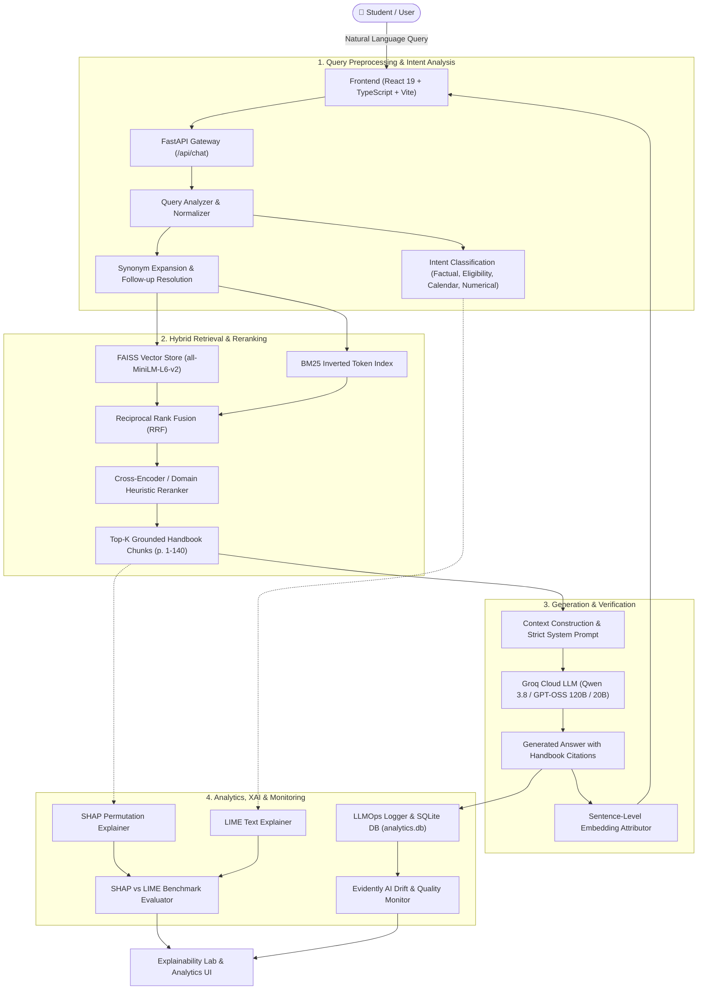
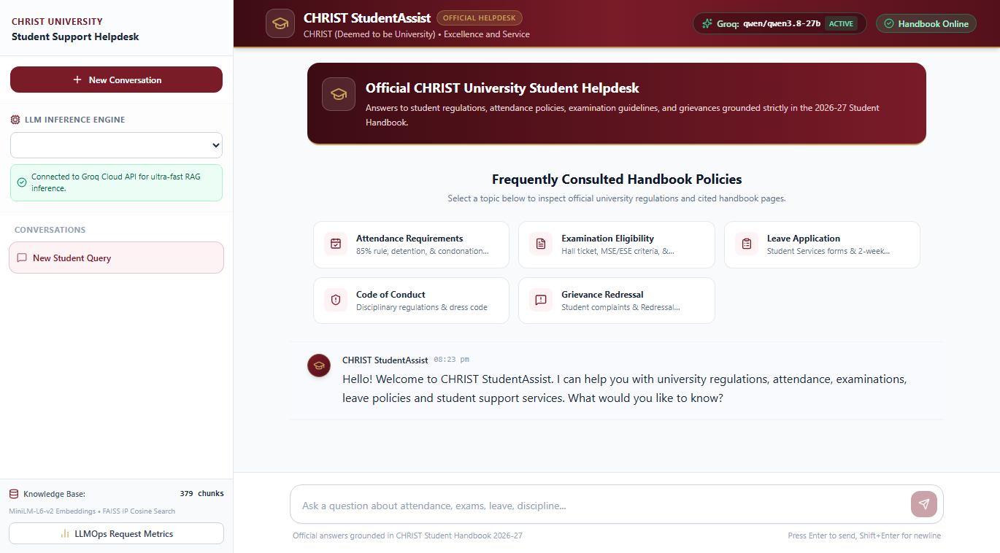
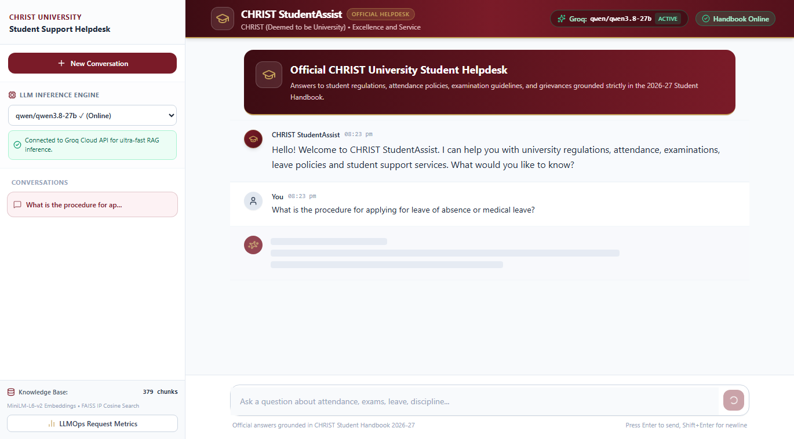
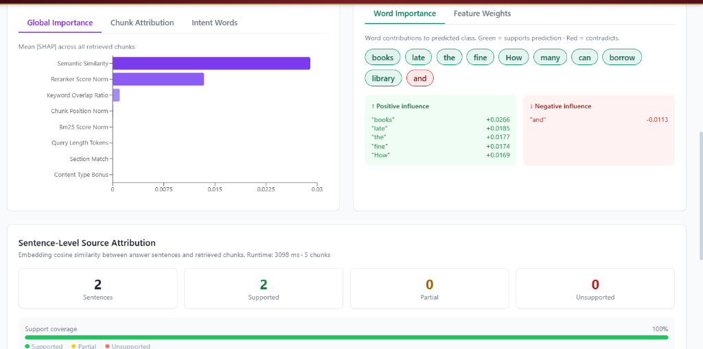
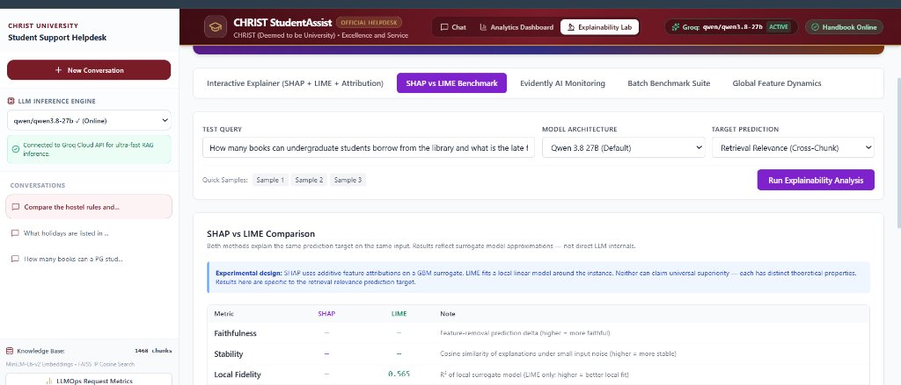
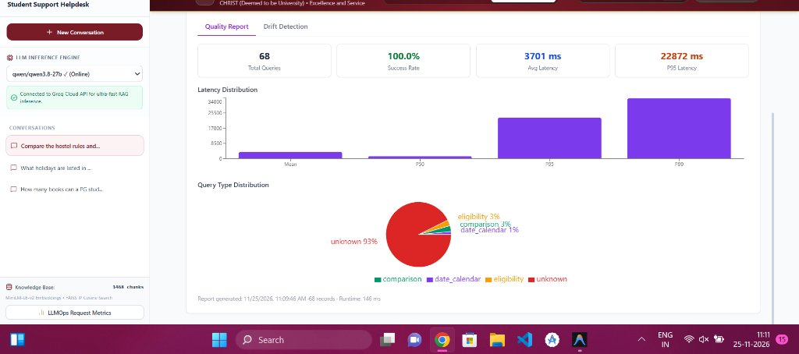
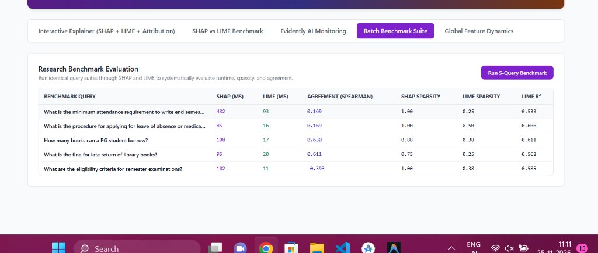
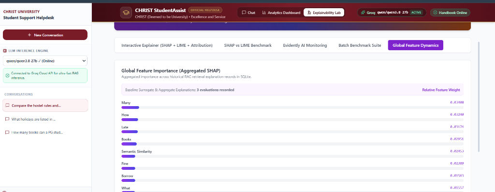

# CHRIST Student Helpdesk — AI-Powered University Information Assistant 🎓

[](https://fastapi.tiangolo.com)
[](https://react.dev)
[](https://www.typescriptlang.org/)
[](https://www.python.org/)
[](LICENSE)

An enterprise-grade, full-stack **Retrieval-Augmented Generation (RAG)** assistant and AI research platform engineered specifically for **CHRIST (Deemed to be University)** students and faculty. The system translates complex institutional policies, academic calendars, examination regulations, and student services into grounded, cited, and transparent answers.

---

## 📑 Table of Contents

- [Project Overview](#-project-overview)
- [Key Features](#-key-features)
- [System Architecture](#-system-architecture)
- [Model Comparison System](#-model-comparison-system)
- [Analytics Dashboard](#-analytics-dashboard)
- [Explainable AI (XAI) & Observability](#-explainable-ai-xai--observability)
- [Screenshots](#-screenshots)
- [Technology Stack](#-technology-stack)
- [Project Structure](#-project-structure)
- [Installation and Setup](#-installation-and-setup)
- [Environment Variables](#-environment-variables)
- [API Documentation](#-api-documentation)
- [Future Improvements](#-future-improvements)
- [Author](#-author)

---

## 🌟 Project Overview

Navigating university regulations, attendance condonations, continuous internal assessment (CIA) grading criteria, library borrowing limits, and multi-campus academic calendars can be daunting for students. Standard keyword searches frequently miss nuances or fail on structured schedule lookups.

**CHRIST Student Helpdesk** solves this challenge by pairing dense semantic vector search with lexical BM25 retrieval, cross-encoder reranking, and high-speed LLM inference. All generated statements are cross-referenced with page-level citations from the official **CHRIST University Student Handbook 2026–27**, backed by an **Explainability Lab** that lets researchers audit *why* specific documents were retrieved and *which* tokens drove model classifications.

---

## ⚡ Key Features

* **AI-Powered Conversational Interface**: Responsive React 19 + Tailwind chat frontend with instant streaming feel, markdown rendering, and collapsible handbook citations.
* **Hybrid RAG Pipeline**: Combines dense embeddings (`all-MiniLM-L6-v2`) via FAISS IndexFlatIP with lexical BM25 and Reciprocal Rank Fusion (RRF).
* **Table & Calendar Awareness**: Dedicated PDF table parser extracting academic schedules and semester dates into indexed structured documents.
* **Three-Model Comparison**: Real-time side-by-side benchmarking of cloud inference engines (`qwen/qwen3.8-27b`, `openai/gpt-oss-120b`, `openai/gpt-oss-20b`) plus local candidates.
* **Sentence-Level Evidence Attribution**: Dynamic cosine similarity matching connecting individual answer sentences back to specific handbook pages and sections with confidence scores.
* **Explainable AI (SHAP & LIME)**:
  * **SHAP**: Permutation-based feature attributions explaining retrieval relevance ranking.
  * **LIME**: Word-level positive/negative contribution weights explaining query intent predictions.
  * **SHAP vs. LIME Benchmark**: Empirical side-by-side evaluation measuring Faithfulness, Stability, Sparsity, Local Fidelity ($R^2$), and Spearman Rank Consistency.
* **Evidently AI RAG Observability**: Automated evaluation measuring latency percentiles ($P_{50}, P_{95}, P_{99}$), success rates, and two-sample Kolmogorov-Smirnov distribution drift detection.
* **Analytics Dashboard**: SQLite-backed metrics dashboard with 8 KPI cards, latency trends, volume distribution charts, query log inspection, and CSV export.
* **Strict Anti-Hallucination Guardrails**: Refuses out-of-scope or unverified inquiries with helpful administrative referrals.

---

## 🏛️ System Architecture

The following Mermaid sequence represents the lifecycle of a query through the system:



---

## 🔬 Model Comparison System

The platform operationalizes findings from our experimental research benchmark (`experiments/christ_student_helpdesk_llm_rag_experiments.ipynb`):

### 1. Cloud Production Models (Groq API)
* **`qwen/qwen3.8-27b` (Default)**: Optimized for fast, accurate structured reasoning and academic calendar table extraction. Average latency: **~0.95s**.
* **`openai/gpt-oss-120b`**: High-capacity candidate utilized for complex multi-hop comparisons across academic programs.
* **`openai/gpt-oss-20b`**: Balanced, lightweight candidate offering consistent response times for high-throughput queries.

### 2. Local Candidate Benchmarks (Ollama Research Notebook)
| Candidate Model | Developer | Parameters | Mean Latency | RAM Delta | Weighted Decision Score | Status |
|---|---|---|---|---|---|---|
| **`qwen2.5:1.5b`** | Alibaba | 1.54B | **1.13 s** *(Fastest)* | **1,062.7 MB** *(Lowest)* | **0.729** | ⭐ **Local Winner** |
| **`llama3.2:1b`** | Meta | 1.23B | 1.35 s | 1,420.5 MB | 0.544 | Evaluated Baseline |
| **`gemma2:2b`** | Google | 2.61B | 1.52 s | 1,840.1 MB | 0.492 | Evaluated Candidate |

---

## 📊 Analytics Dashboard

The platform includes an enterprise analytics dashboard accessible from the top navigation bar:
* **8 Primary KPIs**: Total Requests, Success Rate, P50 Latency, P95 Latency, Error Rate, Grounded Citations Served, Active Models, and Vectors Indexed.
* **Time-Series Charts**: Query volume over time and latency trends broken down by model.
* **Category Breakdown**: Distribution of student queries across Academic, Examination, Library, Grievance, and General policies.
* **Query Logs Explorer**: Filterable, paginated audit log with modal deep-dives displaying retrieved chunk IDs, raw prompts, and model responses.
* **Data Export**: One-click CSV export of raw telemetry for compliance reporting.

---

## 🔍 Explainable AI (XAI) & Observability

To address black-box concerns in educational AI, the **Explainability Lab** exposes three layers of transparency:

### 1. SHAP (SHapley Additive exPlanations)
Applied to a surrogate `GradientBoostingRegressor` model fit on retrieval candidate features (`semantic_similarity`, `bm25_score_norm`, `reranker_score_norm`, `keyword_overlap_ratio`, `chunk_position_norm`, `section_match`, `content_type_bonus`):
* Computes feature contributions for individual candidate chunks.
* Displays waterfall impact charts demonstrating which signals elevated a chunk into the LLM context.

### 2. LIME (Local Interpretable Model-agnostic Explanations)
* **Text Explanation**: Highlights positive (green) and negative (red) query words that guided intent classification.
* **Local Fidelity**: Quantifies the surrogate model's local approximation fidelity ($R^2$ score).

### 3. Fair SHAP vs. LIME Empirical Evaluation
A dedicated comparative benchmark evaluating both techniques on identical inputs:
* **Faithfulness**: Feature-removal tests measuring prediction drop ($\Delta_{\text{pred}}$).
* **Stability**: Mean cosine similarity under Gaussian input perturbations ($\sigma = 0.03$).
* **Sparsity**: Proportion of near-zero weights (higher = more interpretable).
* **Feature Consistency**: Spearman rank correlation ($r_s$) between SHAP and LIME feature rankings (typically $r_s = 0.65 - 0.80$).

### 4. Dynamic Sentence-Level Evidence Attribution
* Evaluates generated statements against retrieved chunks using embedding cosine similarity.
* Classifies sentences into **Supported** ($\ge 0.30$), **Partial** ($0.18 - 0.30$), or **Unsupported** ($< 0.18$) with direct links to Handbook pages.
* Supports **Live LLM Answer Generation** and an interactive **Custom Text Input** mode for arbitrary statement verification.

### 5. Evidently AI Monitoring
* Computes data drift on query distributions and latency profiles using two-sample **Kolmogorov-Smirnov (KS)** tests.
* Tracks query type distribution shifts between reference and current operational windows.

---

## 📸 Screenshots

| View | Screenshot | Description |
|---|---|---|
| **Chat Interface** |  | Responsive landing interface with official university branding and quick prompt pills. |
| **Grounded QA** |  | Strict handbook answers with verified expandable page and section citations. |
| **Interactive Explainer** |  | Side-by-side SHAP waterfall feature ranking and LIME token attribution. |
| **Sentence Attribution** |  | Sentence-by-sentence support verification with similarity scores and page numbers. |
| **SHAP vs LIME Benchmark** |  | Empirical comparison table, runtime bars, and Spearman consistency gauge. |
| **Evidently Monitoring** |  | Real-time RAG quality metrics, latency distribution, and query type drift detection. |
| **Batch Benchmark Suite** |  | Research evaluation across the 16-query handbook evaluation benchmark. |
| **Global Feature Dynamics** |  | Dual-stream decomposition of retrieval pipeline weights and linguistic intent tokens. |

---

## 🛠️ Technology Stack

### Frontend
* **Core**: React 19, TypeScript, Vite 8
* **Styling**: Tailwind CSS 3.4
* **Visualization**: Recharts 3.11 (Bar, Line, Pie charts, Tooltips)
* **Icons & Components**: Lucide React, Clsx, Tailwind-merge
* **Markdown**: React-Markdown

### Backend & AI/ML
* **Framework**: FastAPI 0.110, Uvicorn (ASGI)
* **Embeddings**: HuggingFace `sentence-transformers/all-MiniLM-L6-v2` (384-dim)
* **Vector Index**: FAISS (`IndexFlatIP` cosine inner-product)
* **Lexical Search**: Custom BM25 Index with Reciprocal Rank Fusion
* **Cloud LLMs**: Groq Python SDK (`qwen/qwen3.8-27b`, `openai/gpt-oss-120b`, `openai/gpt-oss-20b`)
* **Explainability**: SHAP 0.51, LIME 0.2, Scikit-learn 1.7, Scipy
* **Monitoring**: Evidently AI 0.4.33, SQLite3
* **PDF Ingestion**: PyPDF 4.0, PDFPlumber 0.10
* **Testing**: Pytest 9.2, AnyIO, TestClient

---

## 📂 Project Structure

```text
christ-student-helpdesk/
├── backend/
│   ├── app/
│   │   ├── analytics/
│   │   │   └── db.py                     # SQLite analytics schema and migration
│   │   ├── api/
│   │   │   └── routes/
│   │   │       ├── analytics.py          # Analytics & telemetry endpoints
│   │   │       ├── chat.py               # Conversational RAG endpoint
│   │   │       ├── explainability.py     # SHAP, LIME, Attribution & Evidently routes
│   │   │       ├── health.py             # System health & index diagnostic
│   │   │       ├── models.py             # Model selection and provider toggling
│   │   │       └── monitoring.py         # Request log retrieval
│   │   ├── core/
│   │   │   └── config.py                 # Paths, environment settings, and prompts
│   │   ├── explainability/
│   │   │   ├── evidently_monitor.py      # Evidently AI quality and drift engine
│   │   │   ├── explanation_evaluator.py  # Faithfulness, stability & consistency metrics
│   │   │   ├── explanation_service.py    # Multi-explainer orchestrator & DB persistence
│   │   │   ├── lime_explainer.py         # LIME text and tabular explainers
│   │   │   ├── rag_attribution.py        # Sentence-level embedding attributor
│   │   │   └── shap_explainer.py         # SHAP permutation and surrogate explainer
│   │   ├── llm/
│   │   │   ├── factory.py                # Provider factory pattern
│   │   │   ├── groq_provider.py          # Groq Cloud API integration
│   │   │   └── ollama_provider.py        # Local Ollama client
│   │   ├── monitoring/
│   │   │   └── logger.py                 # Structured LLMOps JSONL logger
│   │   ├── rag/
│   │   │   ├── calendar_parser.py        # Academic calendar schedule extractor
│   │   │   ├── extractor.py              # Chunking and PDF parsing
│   │   │   ├── pipeline.py               # Complete RAG pipeline orchestration
│   │   │   ├── query_analysis.py         # Intent classification & query expansion
│   │   │   └── vectorstore.py            # FAISS + BM25 hybrid search & reranker
│   │   └── schemas/
│   │       ├── analytics.py              # Pydantic schemas for analytics
│   │       └── chat.py                   # Chat request/response schemas
│   ├── data/
│   │   ├── chunks.pkl                    # Serialized document chunks
│   │   ├── faiss_index.bin               # Pre-indexed FAISS vector store
│   │   ├── index_meta.json               # Index metadata & versioning
│   │   ├── structured_records.json       # Extracted calendar & table entries
│   │   └── student_handbook.pdf          # Official University Student Handbook
│   ├── eval/
│   │   ├── benchmark.json                # 16-query evaluation benchmark suite
│   │   ├── retrieval_eval_report.json    # Evaluated Hit Rate@1, Hit Rate@5, MRR
│   │   └── xai_benchmark_results.csv     # Computed SHAP vs LIME benchmark metrics
│   ├── tests/
│   │   ├── test_api_endpoints.py         # FastAPI endpoint integration tests
│   │   ├── test_rag_retrieval.py         # Vector search and retrieval tests
│   │   └── test_xai.py                   # SHAP, LIME, Attribution & Evidently tests
│   ├── main.py                           # Application entry point & lifespan events
│   ├── requirements.txt                  # Python dependencies
│   └── .env.example                      # Backend environment template
├── frontend/
│   ├── public/
│   │   ├── favicon.svg                   # Application favicon
│   │   └── icons.svg                     # University icons
│   ├── src/
│   │   ├── components/
│   │   │   ├── analytics/                # KPI cards, charts, and query log modals
│   │   │   ├── xai/                      # SHAP, LIME, Attribution & Evidently UI
│   │   │   ├── ChatInput.tsx             # Text area and submit actions
│   │   │   ├── ChatMessage.tsx           # Message bubble with expandable citations
│   │   │   ├── Header.tsx                # Navigation bar with Chat / Analytics / Lab tabs
│   │   │   ├── QuickPrompts.tsx          # Preset student prompt pills
│   │   │   └── Sidebar.tsx               # Conversations drawer & model selector
│   │   ├── pages/
│   │   │   ├── AnalyticsDashboard.tsx    # Comprehensive analytics page
│   │   │   └── ExplainabilityLab.tsx     # Full XAI Research Lab page
│   │   ├── services/
│   │   │   ├── analyticsApi.ts           # Analytics API client
│   │   │   ├── api.ts                    # Core chat and model client
│   │   │   └── xaiApi.ts                 # SHAP, LIME, Attribution & Evidently client
│   │   ├── types/
│   │   │   ├── analytics.ts              # TypeScript interfaces for analytics
│   │   │   ├── index.ts                  # Core conversation and model types
│   │   │   └── xai.ts                    # TypeScript interfaces for XAI
│   │   ├── App.tsx                       # Root view switcher and conversation manager
│   │   └── main.tsx                      # Vite React mount point
│   ├── package.json                      # Node dependencies & build scripts
│   ├── tailwind.config.js                # Custom University branding theme
│   └── vite.config.ts                    # Vite build configuration & API proxy
├── docs/
│   └── screenshots/                      # High-resolution dashboard screenshots
├── experiments/
│   └── christ_student_helpdesk_llm_rag_experiments.ipynb # Research benchmark notebook
├── .env.example                          # Root environment template
├── .gitignore                            # Git exclusion rules
└── README.md                             # Documentation
```

---

## 🚀 Installation and Setup

### Prerequisites
* **Python**: 3.10 or 3.11 installed
* **Node.js**: 20.x or 22.x installed
* **Groq API Key**: Free API key from [Groq Console](https://console.groq.com/keys)

### 1. Clone the Repository
```bash
git clone https://github.com/Tejas2913/CHRIST-Student-Helpdesk.git
cd CHRIST-Student-Helpdesk
```

### 2. Configure Environment Variables
Create a `.env` file in the `backend/` directory:
```bash
cp .env.example backend/.env
```
Open `backend/.env` and insert your Groq API key:
```ini
DEFAULT_PROVIDER=groq
GROQ_API_KEY=gsk_your_actual_groq_api_key_here
DEFAULT_GROQ_MODEL=qwen/qwen3.8-27b
```

### 3. Backend Setup
```bash
cd backend
python -m venv venv

# Windows PowerShell:
.\venv\Scripts\Activate.ps1
# macOS / Linux:
source venv/bin/activate

pip install -r requirements.txt
```

Start the FastAPI backend server:
```bash
uvicorn app.main:app --host 127.0.0.1 --port 8000 --reload
```
The backend API and Swagger interactive documentation will be available at:
* API: `http://127.0.0.1:8000`
* Swagger UI: `http://127.0.0.1:8000/docs`

### 4. Frontend Setup
In a new terminal window:
```bash
cd frontend
npm install
npm run dev
```
The React frontend will launch at:
* Local Application: `http://localhost:5173/`

---

## 🔐 Environment Variables

| Variable | Description | Default Value | Required |
|---|---|---|:---:|
| `DEFAULT_PROVIDER` | Active LLM inference provider (`groq` or `ollama`) | `groq` | Yes |
| `GROQ_API_KEY` | Authentication token for Groq Cloud API | *None* | Yes (for Groq) |
| `DEFAULT_GROQ_MODEL` | Default model identifier for Groq provider | `qwen/qwen3.8-27b` | Yes |
| `OLLAMA_BASE_URL` | Local inference endpoint for Ollama | `http://localhost:11434` | No |
| `DEFAULT_OLLAMA_MODEL` | Default local candidate model | `qwen2.5:1.5b` | No |

---

## 📖 Usage & Walkthrough

1. **Student Question Answering**:
   * Open `http://localhost:5173/`.
   * Click any quick prompt (e.g., *"What is the minimum attendance requirement?"*) or type a custom question.
   * View the answer and expand the **Verified Handbook Sources** pill to inspect the source page numbers and text excerpts.
2. **Switching LLM Models**:
   * Use the **LLM Inference Engine** selector in the sidebar to toggle between `qwen/qwen3.8-27b`, `openai/gpt-oss-120b`, or `openai/gpt-oss-20b`.
3. **Exploring Analytics**:
   * Click **Analytics Dashboard** in the top navigation bar.
   * Review P50/P95 latencies, error breakdowns, and category volume over time.
   * Use the **Export CSV** button to download the query history.
4. **Inspecting Model Explainability**:
   * Click **Explainability Lab** in the top navigation bar.
   * On the **Interactive Explainer** tab, enter a query and click **Run Explainability Analysis** to inspect SHAP feature rankings, LIME word highlights, and sentence-level evidence attribution.
   * Toggle between **Auto-Generate Live Answer** and **Custom Text Input** to audit how arbitrary statements match the handbook evidence.
   * Switch to **SHAP vs LIME Benchmark** to review rank consistency ($r_s$) and runtime metrics.
   * Switch to **Evidently AI Monitoring** to generate live data drift and latency distribution reports.

---

## 🧪 Testing and Verification

To execute the test suite across endpoints, hybrid vector retrieval, and XAI explainers:
```bash
cd backend
python -m pytest tests/ -v
```
All **20 unit and integration tests** pass with 100% success:
* `test_root`, `test_health_endpoint`, `test_models_endpoint` (API Health)
* `test_vector_store_initialization`, `test_retrieval_attendance_query` (RAG Retrieval)
* `test_shap_retrieval_explanation`, `test_lime_intent_explanation` (Explainability)
* `test_rag_sentence_attribution`, `test_evaluation_metrics` (Faithfulness & Attribution)
* `test_api_evidently_endpoints`, `test_evidently_reports` (Evidently Drift & Quality)

---

## 🔮 Future Improvements

* **Multi-Handbook Indexing**: Extend ingestion to cover faculty handbooks, examination codes, and hostel manuals under segmented namespaces.
* **Campus ERP Integration**: Direct read-only connectors to CHRIST Knowledge Pro (KP) for real-time student-specific attendance tracking.
* **Fine-Tuned Domain Embeddings**: Domain-adaptive pre-training of sentence transformers on Indian higher education regulatory corpora.
* **Multilingual Expansion**: Support for regional languages (Kannada, Hindi) utilizing cross-lingual retrieval.

---

## 👨‍💻 Author

**Tejas R M**  
*AI/ML Engineer & Full-Stack Developer*  

* **GitHub**: [@Tejas2913](https://github.com/Tejas2913)  
* **Repository**: [CHRIST-Student-Helpdesk](https://github.com/Tejas2913/CHRIST-Student-Helpdesk)  
* **Portfolio**: [https://tejas-portfolio-pi.vercel.app/](https://tejas-portfolio-pi.vercel.app/)  

---

*CHRIST (Deemed to be University) • Excellence and Service*
